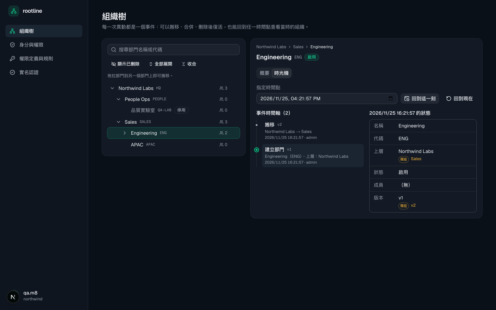

# rootline

多租戶 SaaS 的身分與組織架構平台：管理使用者、角色、群組、實名認證，以及可以無限層級、能合併、能「回到過去」的組織樹。



後端 6 個服務 + Gateway 以事件串接；前端有組織樹編輯器（拖拉搬移、合併、刪除後復活、時光機）、身分與權限、租戶管理、權限定義與 API 規則、實名認證與審核。各頁面說明與截圖見 [docs/features.md](docs/features.md)。

## 解決什麼問題

- 大型組織重組（搬移、合併、刪除後復原部門）時，需要完整、可追溯的異動紀錄，並能查任一時間點的組織狀態
- 多租戶之間的資料與權限隔離；平台營運人員與租戶管理員權限分離
- 權限異動要即時反映到各服務，但服務之間不能共用資料庫
- 實名資料要能審核，又不能讓完整證號留在系統裡

## 重點技術

- 後端：Java 21、Spring Boot 4.2、Spring Cloud Gateway（MVC）、六角架構、戰術 DDD、CQRS、Event Sourcing、Outbox Pattern
- 資料：PostgreSQL（每服務一個 DB，Flyway 管 schema）、Redis（限流、動態權限規則）、Kafka 4（KRaft，冪等消費與 DLT）
- 安全：RS256 JWT + JWKS、雙軌權限（註解 + 租戶動態規則，只能收緊）、證號只存遮罩與 HMAC 指紋
- 前端：Next.js 16（App Router、Partial Prerendering）、React 19、Tailwind 4、shadcn/ui、TanStack Query；BFF 代理，token 只存在 httpOnly cookie
- 測試：JUnit 5、Testcontainers（PostgreSQL / Kafka / Redis）、ArchUnit

## 服務

| 服務 | Port | 職責 |
|---|---|---|
| gateway | 9000 | 唯一入口：JWT 驗證、身分 header 注入、限流、熔斷 |
| auth-service | 8080 | 使用者、角色、群組、登入、權限字典投影 |
| dept-tree-service | 8081 | 組織樹（Event Sourcing + 閉包表）、時光機、權限定義、動態 API 規則 |
| tenant-service | 8082 | 租戶開通、停權、方案（僅平台營運人員） |
| kyc-service | 8083 | 實名送審、審核佇列、核准 / 駁回 |
| userprofile-service | 8084 | 個人檔案（身分與實名狀態由事件投影） |
| Kafka UI | 8090 | 檢視 topic 與訊息 |

開通一個租戶時，tenant-service 只發出 `TenantProvisioned`：auth 建立管理員、dept-tree 建立根部門並定義內建權限，權限定義再流回 auth 的權限字典。各服務互不呼叫。

## 本機啟動

需要 Java 21、Docker。

```bash
cp deploy/.env.example deploy/.env   # 每個 change-me 都要換掉
docker compose -f deploy/docker-compose.yml --env-file deploy/.env up -d
cd backend && ./mvnw verify && cd ..
```

啟動全部服務（auth 的 dev profile 會建立虛構租戶 `northwind` 的 `admin`，以及平台營運帳號 `platform` / `operator`，密碼都取自 `ROOTLINE_SEED_ADMIN_PASSWORD`）。所有 API 一律走 Gateway 的 9000：

```bash
set -a && source deploy/.env && set +a
java -jar backend/auth-service/target/auth-service-0.1.0-SNAPSHOT.jar --spring.profiles.active=dev &
for s in dept-tree-service tenant-service kyc-service userprofile-service gateway; do
  java -jar backend/$s/target/$s-0.1.0-SNAPSHOT.jar &
done
```

前端（需要 Node 20+、pnpm），開 http://localhost:3000 以 `northwind` / `admin` 登入：

```bash
cd frontend && pnpm install && pnpm dev
```

瀏覽器只跟 Next.js 溝通：登入後 JWT 存在 httpOnly cookie，`/api/bff/*` 由伺服器端帶上 Bearer token 轉給 Gateway；寫入請求要求自訂 header 並檢查 Origin 防 CSRF。Gateway 位址可用 `ROOTLINE_GATEWAY_URL` 覆寫。

## 限制

- 下游服務信任 Gateway 注入的身分 header，所以只能讓 Gateway 對外；本機直接打 8080–8084 會繞過驗證（正式部署需用網路隔離，尚未做）
- 租戶停權後無法再登入，但已發出的 token 在到期前（8 小時）仍可使用；Gateway 尚未即時檢查租戶狀態
- 跨服務資料為最終一致：例如開通租戶後約 1 秒管理員才能登入、指派人員後數百毫秒才出現在 permissions-context
- 動態 API 規則各服務本機快取 30 秒，修改後最多 30 秒才在其他服務生效
- Outbox 為「至少一次」送出，消費端靠 eventId 冪等；多個 relay 實例並行時，跨聚合的事件順序不保證
- 開通事件帶管理員密碼的 bcrypt hash（不是明文），會在 outbox 表保留到清除期限（預設 7 天）
- KYC 不處理證件影像上傳；租戶合約到期（EXPIRED）不會自動處理
- 限流以 TCP 連線端 IP 計，前面若有 reverse proxy 需另設 RemoteIpValve
- 前端顯示選單用的權限是解析 JWT 得到的，不驗簽，只影響畫面；真正的授權仍由 Gateway 與各服務判斷
- 前端沒有自動化測試，目前靠手動瀏覽器驗證
- 租戶管理頁只開放給 `platform` 租戶；平台租戶的帳號只能由 seeder 建立（沒有平台內的帳號管理畫面）
- KYC 審核佇列一次只看一種狀態；被駁回後重新送審要重新輸入證件號碼（系統只保留遮罩）
- 組織樹拖拉搬移使用原生 HTML5 Drag and Drop，只支援滑鼠；觸控裝置請用節點選單的「搬移到…」
- 調整排序時同層部門會逐一重新編號，每個變動都是一個事件，中途失敗可能只套用一部分（重新整理即可看到實際結果）
- 只在本機與 CI 跑過，沒有正式部署
