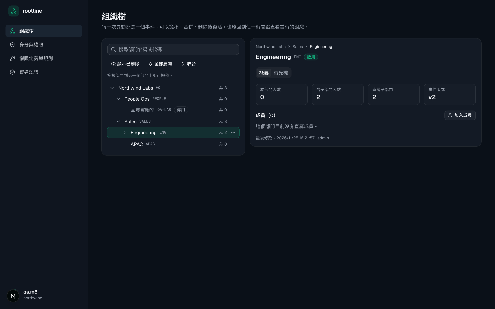
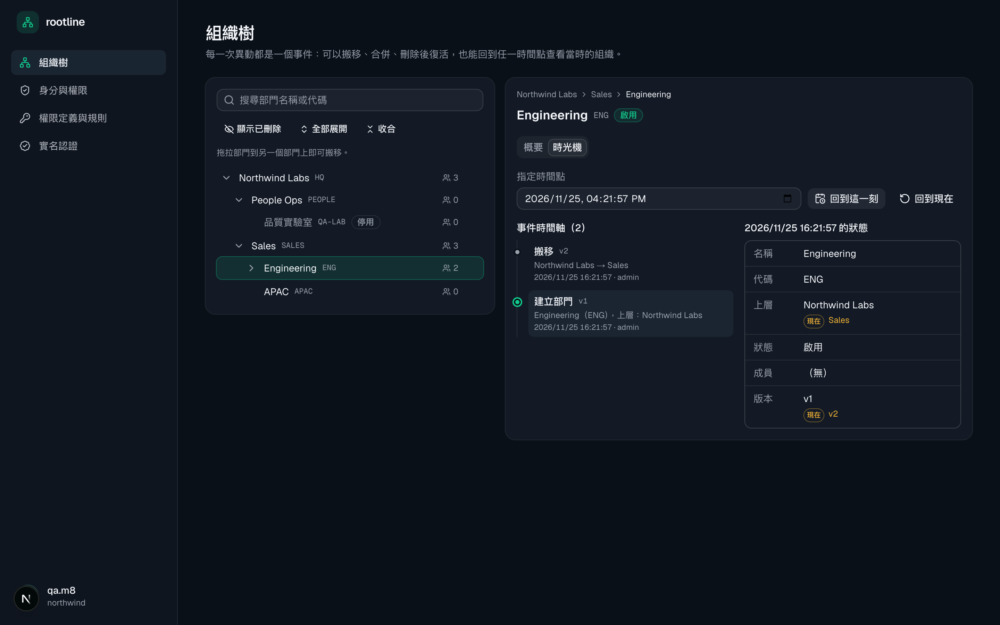
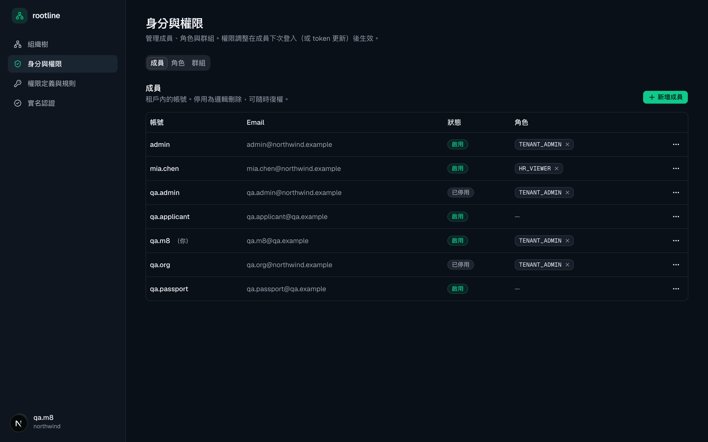
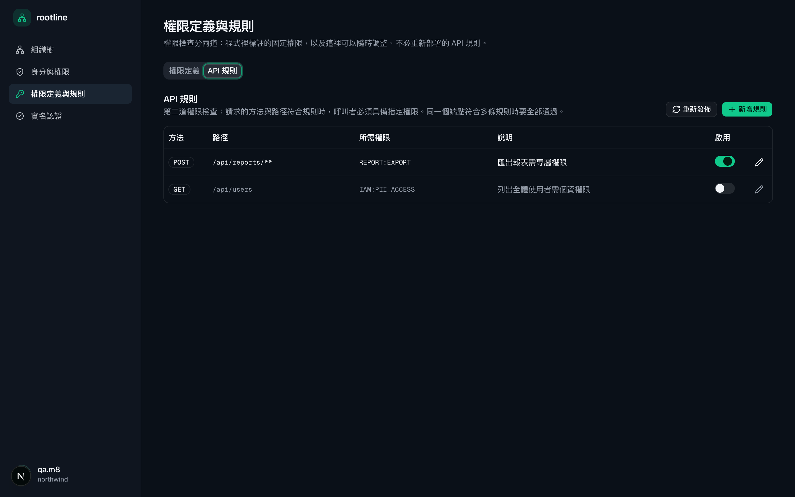
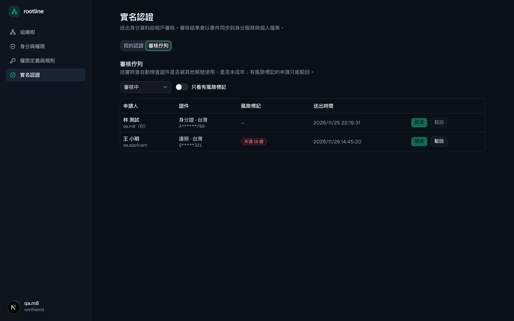
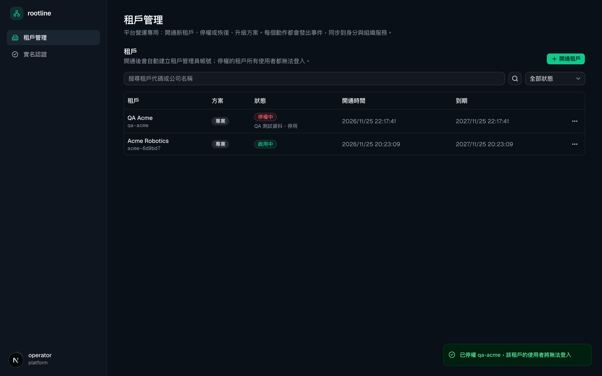

# 功能說明

所有截圖都是本機 dev 環境的虛構租戶 `northwind`，帳號與人名皆為測試資料。

## 組織樹 `/dashboard/org-tree`

- 無限層級的部門樹：展開 / 收合、搜尋（命中的部門連同上層一起顯示）、停用與已刪除部門以樣式區分
- 節點操作：新增子部門、改名、同層排序、搬移、合併、停用、刪除（連同子部門）、管理直屬成員
- 拖拉搬移：拖到自己的子部門、已停用或已刪除的部門不會被接受，放開後先確認
- 後端每個異動都是 `department_events` 裡的一筆事件；閉包表投影在同一個交易內更新，所以寫完立即可讀

### 時光機

- 列出部門的所有事件；點事件或指定任一時間點，後端重播事件得到當時的狀態，並標出與現在不同的欄位
- 已刪除的部門打開「顯示已刪除」後可以一鍵復活（連同一起被刪的子部門）

## 身分與權限 `/dashboard/iam`

- 成員、角色、群組三個分頁；角色授予權限、群組帶角色，成員最終權限 = 個人角色 + 群組角色
- 點成員可看權限脈絡：權限從哪個角色、哪個群組來，以及所屬部門

## 權限定義與 API 規則 `/dashboard/dept-permissions`

權限檢查分兩道：

1. **固定權限**：程式裡以 `@RequiresPermission` 標註，所有服務共用同一個攔截器
2. **API 規則**：租戶自訂「方法 + 路徑 → 所需權限」，存資料庫並發佈到 Redis，各服務每 30 秒重新讀取；同一端點符合多條規則時要全部通過，所以規則只能收緊、不能放寬

權限定義也是有版本的聚合，異動以事件送到 auth-service 的權限字典，角色授權時就能選到。

## 實名認證 `/dashboard/kyc`

- 本人送審：姓名、出生日期、證件（身分證 / 護照 / 居留證）、居住地址；台灣身分證在前後端都會驗檢查碼
- 證件號碼只保存遮罩（例如 `A******789`）與 HMAC 指紋，用指紋偵測同一份證件被多個帳號使用
- 送審時自動加上風險標記（證件重複、未滿 18 歲）；有標記的申請只能駁回
- 職務分離：審核人不能審自己的申請
- 駁回要填原因，申請人看得到並可修正後重送

## 租戶管理 `/dashboard/tenants`

只有 `platform` 租戶裡具備 `PLATFORM:TENANT_READ` 的營運人員看得到（一般租戶的 `*:ADMIN_ALL` 只代表自己租戶內的全部權限）。

- 搜尋、狀態篩選、分頁
- 開通：建立租戶並發出 `TenantProvisioned`，auth-service 建立管理員、dept-tree-service 建立根部門
- 停權（必填原因）、恢復、升級方案（只能往上升）
